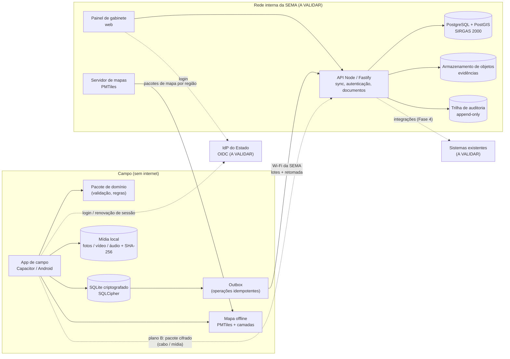

# Plano de Evolução — Sistema de Fiscalização Ambiental (SEMA/MT)

**Origem:** protótipo "Governança de Projetos Ambientais" (repositório `claudePiloto6`, commit `8613252`)
**Data:** 2026-11-06
**Situação:** proposta para discussão. Nenhum código foi alterado para produzir este documento.

> **Andamento (2026-11-06):** a "fundação sem dependências" foi implementada na branch `feat/fiscalizacao-fundacao`. Ela inclui:
>
> - correção das dívidas D1 a D6, D8 e D9 no protótipo;
> - pacote de domínio (`public/js/dominio/`);
> - API de sincronização idempotente, talonário por blocos e auditoria encadeada (`src/api/`, com `node:sqlite` interino);
> - ADRs 003, 004, 007 e 011 em `docs/adr/`.
>
> Ficaram fora desse recorte:
>
> - D7, D10 e D11, que dependem da troca do `localStorage` e da UI;
> - D12 a D16;
> - os itens que dependem da Fase 0 (app Capacitor, IdP, hospedagem, modelos oficiais).
**Autoria:** elaborado com apoio do Claude Code (Claude Opus 5.5), sob responsabilidade de Fabricio Jorge.

> **Avisos importantes**
>
> - Este documento **não afirma fatos sobre a SEMA/MT**, seus sistemas internos, sua infraestrutura ou seus fluxos atuais. Tudo o que depende disso está marcado como **A VALIDAR** e reunido na [seção 12](#12-perguntas-para-a-sema).
> - Leis e normas citadas servem só de referência inicial. **A vigência, a aplicabilidade e os campos obrigatórios de cada documento devem ser conferidos com a Procuradoria** antes de qualquer implementação.
> - Estimativas de esforço são relativas: **P** = até 1 semana, **M** = 1 a 3 semanas, **G** = mais de 3 semanas, considerando 1 ou 2 desenvolvedores. Elas devem ser recalculadas depois da Fase 0.
> - Prioridades: **MVP** = necessário para o piloto; **Fase 2** = necessário para a implantação ampla; **Futuro** = desejável.

## Sumário

- [Diagnóstico do estado atual](#diagnóstico-do-estado-atual)
- [1. Visão e objetivos](#1-visão-e-objetivos)
- [2. Arquitetura-alvo offline-first](#2-arquitetura-alvo-offline-first)
- [3. Módulos funcionais do domínio de fiscalização](#3-módulos-funcionais-do-domínio-de-fiscalização)
- [4. Geoespacial](#4-geoespacial)
- [5. Sincronização offline](#5-sincronização-offline)
- [6. Segurança, LGPD e validade probatória](#6-segurança-lgpd-e-validade-probatória)
- [7. Qualidade e operação](#7-qualidade-e-operação)
- [8. Governança](#8-governança)
- [9. Roadmap por fases](#9-roadmap-por-fases)
- [10. Backlog inicial](#10-backlog-inicial)
- [11. Riscos e decisões em aberto](#11-riscos-e-decisões-em-aberto)
- [12. Perguntas para a SEMA](#12-perguntas-para-a-sema)

---

## Diagnóstico do estado atual

Análise feita sobre o código versionado: `package.json`, `src/server.js`, `public/js/*.js`, `test/*.test.js`, `e2e/app.spec.js`, `playwright.config.js`, `.github/workflows/ci.yml`, `README.md` e `docs/`. São cerca de 1.100 linhas de código de aplicação e cerca de 1.400 linhas de testes.

### Resumo do que existe

| Camada | Arquivo | O que faz hoje |
|---|---|---|
| Servidor | `src/server.js` | HTTP em Node puro: entrega os arquivos estáticos de `public/`, oferece `/health` e aceita só GET/HEAD. Aplica CSP e cabeçalhos de segurança e bloqueia path traversal. **Não tem API de dados.** |
| Regras de negócio | `public/js/projetos.js` | Funções puras: validação, normalização, filtros combinados, resumo por status e `proximoId`. |
| Persistência | `public/js/repositorio.js` | `criarRepositorio(armazenamento)` sobre o `localStorage` (chave `gpa:projetos:v1`), com armazenamento injetável. |
| Interface | `public/js/app.js` | DOM com `textContent`, modais `<dialog>`, filtros e cadastro. |
| Mapa | `public/js/mapa.js` | Leaflet 1.9.4 em cópia local (`public/vendor/leaflet`) + tiles de `tile.openstreetmap.org`. |
| Clima | `public/js/clima.js` | Geocodificação e clima atual pelo Open-Meteo, com `fetch` injetável, tempo limite e validação das respostas. |
| Testes | `test/*.test.js`, `e2e/app.spec.js` | `node:test` para unidade, servidor e regra de "sem diálogos nativos"; Playwright em desktop e Pixel 7, com APIs simuladas. |
| CI | `.github/workflows/ci.yml` | `npm ci`, `npm audit --audit-level=high` e testes em Node 22/24, depois E2E com Chromium. Permissão `contents: read`. |
| Deploy | README | Vercel, só para demonstração. |

### O que deve ser preservado

| Item | Onde | Por que preservar |
|---|---|---|
| Persistência isolada atrás de uma interface injetável | `public/js/repositorio.js` (`criarRepositorio(armazenamento, …)`) | A interface pode ser mantida com outra implementação (SQLite ou IndexedDB), sem reescrever a UI. É o principal ponto de extensão do projeto. |
| Regras de negócio puras, testáveis no Node | `public/js/projetos.js` | Esse padrão deve virar um **pacote compartilhado** (`dominio/`) usado pelo app de campo, pela API e pelo painel, garantindo a mesma validação nos dois lados da sincronização. |
| Dependências externas injetáveis (`fetchFn`, `cache`) | `public/js/clima.js` | Facilita testes sem rede e a simulação de cenários offline. Deve ser o padrão para o cliente de sincronização. |
| Validação de toda resposta externa antes de usar | `clima.js` (`numero()`, `escolherLocal()`) e `repositorio.js` (`validarProjeto` na leitura) | No sistema real, isso vale também para as respostas da API e para os dados lidos do banco local. |
| `textContent` em vez de `innerHTML`; popup do mapa recebe um elemento | `app.js`, `mapa.js` | Previne XSS. Deve virar uma regra de lint e de revisão. |
| Regra "sem `alert/confirm/prompt`" com teste estático e E2E | `test/sem-dialogos-nativos.test.js`, `e2e/app.spec.js` | Exemplo de regra de UX transformada em teste automatizado. Deve ser mantida e o padrão replicado para outras regras, como "sem `innerHTML`". |
| Confirmação em `<dialog>` com foco inicial em "Cancelar" | `app.js` (`confirmar()`) | Bom padrão para ações destrutivas em campo, como cancelar um auto ou excluir uma evidência. |
| CSP restritiva, cabeçalhos de segurança, proteção contra path traversal e métodos limitados | `src/server.js`, `test/server.test.js` | Base de segurança a ser levada para a API. |
| Bibliotecas de terceiros copiadas localmente, com SRI e licença | `public/vendor/leaflet/` | Funciona sem internet, o que já está alinhado ao uso offline. |
| E2E em perfil móvel com APIs simuladas | `playwright.config.js` (`Pixel 7`), `e2e/app.spec.js` | Ponto de partida para o E2E do fluxo offline e da sincronização. |
| CI com menor privilégio e instalação exata pelo lockfile | `.github/workflows/ci.yml` | Base da CI/CD ampliada (seção 7). |
| Registro contínuo do uso de IA | `docs/RELATORIO_GOVERNANCA.md`, `Claude.md` | Exigência de governança que continua valendo. |

### O que precisa mudar

| Aspecto atual | Problema para a fiscalização | Direção |
|---|---|---|
| `localStorage` síncrono (cerca de 5 MB, só texto) | Não comporta fotos, vídeos ou áudios; o navegador ou o sistema pode apagá-lo; não tem criptografia | SQLite criptografado no aparelho e arquivos de mídia no sistema de arquivos do app (seção 2) |
| Sem API, banco ou servidor de dados (`src/server.js` só serve arquivos) | Não há para onde sincronizar | API Node + PostgreSQL/PostGIS |
| Sem login, perfis ou auditoria | Inviável para dados pessoais e atos administrativos | OIDC com o IdP do Estado, perfis e trilha de auditoria imutável |
| Domínio "projeto" (orçamento, progresso, prazo) | Não corresponde a ocorrência, vistoria, auto, termo ou autuado | Novo modelo de domínio (seção 3). O protótipo vira referência de padrões, não de modelo. |
| Mapa (`tile.openstreetmap.org`) e clima (Open-Meteo) sempre online | Em campo não há rede. A política de uso de tiles da OSMF proíbe a pré-carga em massa para uso offline. | Mapa base e camadas offline servidos pela própria infraestrutura (seção 4). Clima passa a ser opcional e só online. |
| Sem service worker nem manifest | Hoje o app **não abre sem rede** | App empacotado (Capacitor), com todos os recursos locais |
| "Nenhuma dependência de execução em produção" (README) | Inviável para SQLite, criptografia, câmera, PostGIS e validação de esquema | ADR de **política de dependências mínimas e auditadas**: lista aprovada, versões fixadas, SBOM e auditoria na CI |
| Deploy na Vercel | Dados pessoais e probatórios em nuvem pública sem contrato com o Estado | Hospedagem na infraestrutura indicada pela SEMA (A VALIDAR) |

### Dívidas técnicas e riscos encontrados no código

| # | Achado | Arquivo | Risco no contexto de fiscalização | Tratamento |
|---|---|---|---|---|
| D1 | JSON corrompido ou que não é array faz `ler()` chamar `restaurar()`, que **regrava os dados de exemplo por cima** | `public/js/repositorio.js` (`ler`, `restaurar`) | **Perda total** de vistorias não sincronizadas | Nunca sobrescrever em caso de erro de leitura. Pôr em quarentena, alertar e oferecer exportação de emergência. |
| D2 | Registros inválidos são **filtrados em silêncio** na leitura | `repositorio.js` (`dados.filter(... validarProjeto(p).valido)`) | Um registro de campo pode sumir por mudança na regra de validação | Separar "válido para envio" de "legível". Registros que falham vão para quarentena, com motivo. |
| D3 | ID sequencial `max(id) + 1` | `public/js/projetos.js` (`proximoId`) | **Colisão** entre aparelhos offline | UUID v7 gerado no aparelho. Número oficial do documento por talonário (seção 3.7). |
| D4 | Exclusão física, sem registro | `repositorio.js` (`remover`), `app.js` (botão Excluir) | Apagar um ato administrativo sem rastro compromete a validade probatória | Soft delete com motivo; documentos lavrados só são cancelados por termo próprio |
| D5 | Alteração de status sem autor, data/hora ou histórico | `repositorio.js` (`atualizarStatus`) | Não há trilha de auditoria | Eventos de alteração com autor, carimbo de tempo do aparelho e do servidor |
| D6 | Registros sem `criadoEm`, `atualizadoEm`, `versao`, `dispositivoId` | `projetos.js` (`normalizarProjeto`) | Impossível sincronizar ou detectar conflito | Metadados obrigatórios em toda entidade |
| D7 | Cada operação lê e regrava o array inteiro | `repositorio.js` (`ler`/`gravar` em `adicionar`, `atualizarStatus`, `remover`) | Lento e sujeito a corrupção com centenas de registros e mídia | Banco local transacional (SQLite) |
| D8 | Migração ad hoc na leitura (`MIGRACAO_MUNICIPIOS`), chave `…:v1` sem controle de versão | `repositorio.js` | Atualizações do app podem quebrar dados não sincronizados | Migrações numeradas e testadas, com versão de esquema gravada no banco local |
| D9 | Sem `localStorage`, o app passa a usar a memória **em silêncio** | `public/js/app.js` (`armazenamentoDisponivel`) | O fiscal perde o trabalho ao fechar o app sem saber | Falha de armazenamento deve bloquear a coleta e avisar de forma clara |
| D10 | Dados de exemplo carregados automaticamente na 1ª visita | `public/js/dados-exemplo.js`, `repositorio.js` (`restaurar`) | Mistura entre dados fictícios e reais | Dados de exemplo só em build/ambiente de desenvolvimento e homologação, com marca visual |
| D11 | Interface monolítica com estado global de módulo | `app.js` (`idEmDetalhe`, `consultaAtual`), `mapa.js` (`mapaAtual`) | Difícil de evoluir para várias telas e fluxos | Separar por telas/módulos; avaliar um framework leve em ADR |
| D12 | Tiles do OSM consumidos direto de `tile.openstreetmap.org` | `public/js/mapa.js` (`URL_TILES`), CSP em `src/server.js` | Viola a política de uso se houver pré-carga; não funciona offline | Mapa base próprio (seção 4) |
| D13 | Open-Meteo: termos gratuitos são para uso não comercial | `public/js/clima.js`, README | Uso por órgão público precisa de confirmação | A VALIDAR; clima não é requisito do MVP |
| D14 | Datas só no formato `AAAA-MM-DD` em UTC; sem fuso nem hora | `projetos.js` (`dataIsoValida`), `app.js` (`timeZone: 'UTC'`) | Autos exigem data e hora precisas | Carimbo ISO 8601 com fuso, mais a hora do servidor na sincronização (seção 6.4) |
| D15 | Actions fixadas por tag (`@v4`), sem CodeQL, SBOM ou scan de segredos | `.github/workflows/ci.yml` | Risco de cadeia de suprimentos | Fixar por SHA e ampliar a CI (seção 7) |
| D16 | O arquivo de instruções está versionado como `Claude.md` | raiz | Em sistemas que diferenciam maiúsculas, ferramentas que procuram `CLAUDE.md` podem não achá-lo | Renomear em um commit próprio (ponto menor) |

**Conclusão do diagnóstico:** o protótipo deve ser tratado como **base de padrões** (isolamento da persistência, regras puras, testes, CI, segurança de front-end) e não como base de dados ou de modelo. A evolução recomendada reaproveita a organização e as práticas, mas substitui o domínio, a persistência e a infraestrutura.

---

## 1. Visão e objetivos

**Visão:** permitir que o fiscal da SEMA/MT registre vistorias e lavre documentos de fiscalização **no celular, sem internet**, com evidências georreferenciadas e íntegras, e que essas informações cheguem ao gabinete **completas, auditáveis e sem retrabalho de digitação** assim que o aparelho se conecta à rede da SEMA.

### Objetivos

| # | Objetivo | Prioridade | Esforço | Dependências |
|---|---|---|---|---|
| O1 | Eliminar a redigitação de dados de campo no escritório | MVP | G | Módulos 3.3 a 3.7 e sincronização |
| O2 | Garantir que nada coletado offline se perca | MVP | G | Seção 5, D1, D2, D9 |
| O3 | Assegurar integridade e rastreabilidade das evidências (cadeia de custódia) | MVP | M | Seção 6.4 |
| O4 | Reduzir o tempo entre a vistoria e o registro do documento no sistema | MVP | M | Sincronização e triagem (3.9) |
| O5 | Apoiar a decisão em campo com camadas geoespaciais offline | Fase 2 | G | Seção 4 |
| O6 | Dar ao gabinete visão consolidada (painel, prazos, produtividade) | Fase 2 | M | API e 3.10 |

### Indicadores de sucesso (medidos no piloto)

A **linha de base** precisa ser levantada na Fase 0 (A VALIDAR); as metas são propostas iniciais.

| Indicador | Como medir | Meta proposta para o piloto |
|---|---|---|
| Registros perdidos ou corrompidos | Comparação entre o que o aparelho gerou (outbox) e o que o servidor recebeu | **0** |
| Sincronizações concluídas sem intervenção técnica | Logs da API | ≥ 98% |
| Tempo da chegada à SEMA até o registro disponível no sistema | Carimbos do aparelho e do servidor | Mediana ≤ 30 min após conexão |
| Tempo da vistoria até a triagem concluída | Status do fluxo | Redução de 50% em relação à linha de base |
| Documentos devolvidos por erro de preenchimento | Triagem (3.9) | Redução de 50% em relação à linha de base |
| Evidências com hash conferido e GPS válido | Validação no servidor | 100% conferidas; ≥ 95% com precisão GPS ≤ 20 m |
| Colisão de numeração de documentos | Restrição única no banco | **0** |
| Satisfação dos fiscais (SUS, *System Usability Scale*) | Questionário ao fim do piloto | ≥ 70 |
| Tempo para lavrar um auto em campo | Telemetria local (início e fim do formulário) | Definir após a Fase 0 |

---

## 2. Arquitetura-alvo offline-first

### 2.1 Decisão: app de campo — Capacitor (recomendado) vs. PWA

| Critério | PWA (navegador) | Capacitor (app Android nativo com WebView) |
|---|---|---|
| Reaproveitamento do código atual (HTML/JS, módulos puros) | Total | Quase total (mesmo front-end, empacotado) |
| Persistência garantida | IndexedDB pode ser apagado pelo navegador ou sistema sob pressão de espaço; `navigator.storage.persist()` não é garantido | SQLite em arquivo do app; só some se o app for desinstalado ou os dados forem limpos |
| Criptografia do banco local | Feita pela aplicação (WebCrypto), com chave guardada pelo próprio JS | SQLCipher, com a chave protegida pelo Android Keystore |
| Mídia grande (vídeo, muitas fotos) | Cota do navegador variável; arquivos grandes no IndexedDB são frágeis | Sistema de arquivos do app, sem a cota do navegador |
| Câmera, GPS e metadados | Câmera via `getUserMedia`/`<input capture>`; EXIF pode ser removido; GPS só com a tela ativa | Plugins nativos: câmera, GPS com precisão, detecção de localização falsa (mock), relógio do sistema |
| Gestão corporativa (MDM, bloqueio e limpeza remota) | Limitada | Distribuição por MDM ou loja gerenciada, políticas do Android Enterprise |
| Distribuição e atualização | Imediata (servidor) | Loja ou MDM; atualização de conteúdo web por pacote assinado (avaliar) |
| Custo e complexidade | Menor | Maior: build Android, assinatura, pipeline de distribuição |
| iOS | Suportado com mais restrições de armazenamento | Possível, mas fora do escopo do piloto |

**Recomendação:** **Capacitor para Android** no app de campo, com **SQLite criptografado (SQLCipher)** e mídia no sistema de arquivos do app. O argumento decisivo é a **garantia de que os dados não somem** e a **proteção dos dados pessoais** em um aparelho que fica dias offline. O PWA é mais simples, mas não oferece essa garantia de forma controlável. O **painel de gabinete** continua **web** (pode ser PWA), sempre online na rede da SEMA.

**Condição:** confirmar na Fase 0 (spike S1) que os aparelhos são Android e gerenciáveis (A VALIDAR). Se a SEMA não puder distribuir app nativo, a alternativa é PWA com IndexedDB, `storage.persist()` e WebCrypto, aceitando os riscos acima por escrito em ADR.

### 2.2 Componentes

| Componente | Decisão recomendada | Justificativa (ligada ao código atual) | Prioridade | Esforço | Dependências |
|---|---|---|---|---|---|
| Pacote de domínio compartilhado (`dominio/`) | JS puro (ESM), sem DOM nem I/O, com esquemas JSON | Evolução direta de `projetos.js`: a mesma validação no app e na API | MVP | M | Modelo de domínio (Fase 0) |
| App de campo | Capacitor + Android; UI em JS modular (framework leve a decidir em ADR) | Reaproveita os padrões de `app.js` (textContent, `<dialog>`) | MVP | G | S1, ADR-001 |
| Armazenamento local | SQLite + SQLCipher; mídia em arquivos com hash; migrações versionadas | Substitui `repositorio.js` mantendo a interface injetável (agora assíncrona) | MVP | G | ADR-002 |
| Outbox e cliente de sincronização | Módulo próprio, `fetch` injetável (padrão de `clima.js`) | Testável sem rede, como os testes atuais | MVP | G | API de sincronização |
| API | Node 22/24 + **Fastify** (validação por JSON Schema, *hooks*, logs estruturados) | Sai do `node:http` puro de `server.js`, que não escala para autenticação, esquemas e uploads. Mantém CSP, métodos restritos e testes de servidor. | MVP | G | ADR-007 |
| Banco central | **PostgreSQL + PostGIS** | Geometria, restrições únicas (numeração), transações, auditoria | MVP | M | Hospedagem (ADR-005) |
| Evidências | Armazenamento de objetos compatível com S3 (ex.: MinIO on-premises), *buckets* com retenção e versionamento | Mídia fora do banco; hash e metadados no banco | MVP | M | Hospedagem |
| Servidor de mapas | Arquivos **PMTiles** (mapa base e camadas) servidos estaticamente pela API ou por um servidor web | Substitui `tile.openstreetmap.org` (D12) | Fase 2 (base mínima no MVP) | M | Fontes de dados (A VALIDAR) |
| Painel de gabinete | Web (mesma base de UI), online, perfis de gestor e conferente | Reaproveita filtros e resumos de `projetos.js` (`filtrarProjetos`, `resumoPorStatus`) | MVP (triagem) / Fase 2 (painel) | G | API |
| Geração de documentos (PDF) | No aparelho (para entregar ao autuado) e no servidor (versão oficial) | O auto precisa existir offline | MVP | M | Modelos oficiais (A VALIDAR) |
| Observabilidade | Logs JSON, métricas e alertas; telemetria do app enviada na sincronização | Hoje há apenas `console.error` em `app.js` | MVP (logs) / Fase 2 (métricas) | M | Hospedagem |

### 2.3 Diagrama

---

## 3. Módulos funcionais do domínio de fiscalização

> Nomes, campos e fluxos dos documentos abaixo são **genéricos**. Os modelos oficiais da SEMA/MT, os campos obrigatórios e a base legal de cada termo são **A VALIDAR** com a área de fiscalização e com a Procuradoria (perguntas P10 a P15).

### Entidades principais (modelo inicial)

`Ocorrencia` → `OrdemFiscalizacao` → `Vistoria` → (`Evidencia`*, `Pessoa` autuado/interessado, `Imovel`) → `Documento` (auto, termos) → `Ciencia` → `Prazo` / `Recurso`.

Toda entidade terá: `id` (UUID v7), `criadoEm`, `atualizadoEm` (aparelho e servidor), `autorId`, `dispositivoId`, `versao`, `situacaoSync`, `excluidoEm`/`motivoExclusao` (soft delete).

### 3.1 Ocorrências e denúncias

| Item | Prioridade | Esforço | Dependências |
|---|---|---|---|
| Cadastro de ocorrência no painel (origem, descrição, local por ponto ou polígono, anexos) | Fase 2 | M | API, painel |
| Importação de ocorrências de canais existentes (ouvidoria, alertas) | Futuro | G | Integrações (A VALIDAR) |
| Vínculo de ocorrência com ordem de fiscalização | Fase 2 | P | 3.2 |
| Fiscal registra ocorrência nova em campo (flagrante) | MVP | P | Módulo de vistoria |

### 3.2 Ordem de fiscalização e roteiro

| Item | Prioridade | Esforço | Dependências |
|---|---|---|---|
| Ordem com equipe, período, área de atuação e alvos | MVP (simplificada) | M | API, perfis |
| Download da ordem, dos alvos e das camadas da região antes de sair | MVP | M | Sincronização, seção 4 |
| Roteiro com sequência de alvos e distâncias (sem roteamento viário) | Fase 2 | M | Mapa offline |
| Roteamento viário offline | Futuro | G | Dados viários |

### 3.3 Vistoria em campo

| Item | Prioridade | Esforço | Dependências |
|---|---|---|---|
| Vistoria vinculada à ordem ou avulsa, com data/hora, coordenadas e equipe | MVP | M | Banco local |
| **Formulários dinâmicos** definidos por JSON Schema versionado (por tipo de infração), com regras de obrigatoriedade condicional; a versão do formulário fica gravada no registro | MVP (1 formulário) / Fase 2 (editor) | G | Pacote de domínio |
| Fotos com GPS, precisão, azimute (se disponível), data/hora e SHA-256 calculado na captura | MVP | M | Plugin de câmera, 6.4 |
| Vídeo e áudio com os mesmos metadados; limite de tamanho configurável | Fase 2 | M | Armazenamento de mídia |
| Registro de trilha ou polígono de área (caminhar o perímetro ou desenhar no mapa) | Fase 2 | G | Seção 4 |
| Salvamento automático a cada campo (sem perda ao fechar ou ao acabar a bateria) | MVP | M | D1, D9 |

### 3.4 Identificação do autuado

| Item | Prioridade | Esforço | Dependências |
|---|---|---|---|
| Pessoa física ou jurídica: CPF/CNPJ com validação de dígitos verificadores (função pura), nome, endereço, documento de identificação | MVP | P | Pacote de domínio |
| Vínculo com o imóvel: número do **CAR** (formato validado), coordenadas, matrícula (opcional) | MVP | P | — |
| Consulta offline à base de CAR da região baixada antes da saída | Fase 2 | M | Seção 4 |
| Consulta online a cadastros oficiais (Receita, CAR) na triagem | Futuro | G | Convênios e integrações (A VALIDAR) |
| Registro de "autuado não identificado / recusa em identificar-se" | MVP | P | A VALIDAR com a Procuradoria |

### 3.5 Auto de infração

| Item | Prioridade | Esforço | Dependências |
|---|---|---|---|
| Lavratura offline: enquadramento (catálogo de infrações baixado), descrição dos fatos, valores conforme a regra vigente, vínculo com vistoria e evidências | MVP (1 tipo de infração) | G | Catálogo oficial (A VALIDAR), 3.7 |
| Cálculo da multa por função pura e testada; a regra de cálculo é versionada e só aplicada após validação jurídica | MVP | M | Base legal (A VALIDAR) |
| Geração do PDF no aparelho a partir do modelo oficial | MVP | M | Modelos (A VALIDAR) |
| Imutável depois de assinado; correção só por termo de retificação ou cancelamento justificado | MVP | M | 6.5 |

> Referências federais que costumam embasar o tema (a conferir com a Procuradoria quanto à vigência e à aplicação no MT): Lei nº 9.605/1998 e Decreto nº 6.514/2008. A legislação estadual aplicável é **A VALIDAR**.

### 3.6 Termos (embargo, apreensão, notificação, constatação)

| Item | Prioridade | Esforço | Dependências |
|---|---|---|---|
| Modelo genérico de "documento de fiscalização" com tipo, campos próprios e vínculo a uma vistoria e, opcionalmente, a um auto | MVP (estrutura) | M | 3.5 |
| Termo de embargo com polígono da área embargada | Fase 2 | M | Seção 4 |
| Termo de apreensão com lista de bens, depositário e fotos de cada item | Fase 2 | M | — |
| Notificação com prazo e exigência | MVP | P | 3.10 |
| Termo de constatação (vistoria sem infração ou de verificação de cumprimento) | MVP | P | — |
| Quais termos entram no piloto | — | — | **A VALIDAR** (P11) |

### 3.7 Talonário digital (numeração sem colisão offline)

**Decisão recomendada:** **blocos de numeração reservados por aparelho.**

1. Enquanto está online, o aparelho pede à API um bloco por tipo de documento (ex.: 50 números). A API registra o bloco como reservado para `dispositivoId` + `fiscalId`, com restrição única no banco.
2. Offline, o app consome os números em sequência, em transação no SQLite. Um número usado nunca volta a ficar disponível, nem se o documento for cancelado: o cancelamento é registrado.
3. Ao sincronizar, a API confirma que cada número pertence a um bloco daquele aparelho. Se o bloco estiver perto do fim, o app pede outro automaticamente.
4. Números não usados de um aparelho baixado (perda, troca) são **inutilizados** com registro, nunca reaproveitados.
5. Se os blocos acabarem em campo, o app gera um **número provisório** (prefixo do aparelho + UUID curto). O número oficial é atribuído na sincronização, e o documento traz os dois. **A aceitação jurídica disso é A VALIDAR** (P13).

O formato do número oficial (prefixos, ano, unidade) é **A VALIDAR** (P12).

| Item | Prioridade | Esforço | Dependências |
|---|---|---|---|
| Reserva, consumo e confirmação de blocos | MVP | M | API, ADR-004 |
| Inutilização de blocos de aparelho baixado | MVP | P | Gestão de dispositivos |
| Número provisório de contingência | Fase 2 | M | Parecer jurídico |
| Relatório de uso do talonário por fiscal ou aparelho | Fase 2 | P | Painel |

### 3.8 Ciência e assinatura

| Item | Prioridade | Esforço | Dependências |
|---|---|---|---|
| Assinatura manuscrita na tela (autuado e fiscal), com hash do documento no momento da assinatura | MVP | M | 6.4 |
| Registro de recusa de assinatura, com testemunhas, quando aplicável | MVP | P | A VALIDAR com a Procuradoria |
| Entrega de via ao autuado: PDF impresso (impressora portátil Bluetooth) ou enviado depois por e-mail ou aplicativo de mensagem | MVP (impressão ou envio posterior: A VALIDAR) | M | P16 |
| Assinatura eletrônica qualificada do fiscal (ICP-Brasil) ou avançada (gov.br) na versão oficial do servidor | Fase 2 | G | Lei nº 14.063/2020 e MP nº 2.200-2/2001 (conferir com a Procuradoria); IdP |
| Ciência posterior por via postal ou edital (registro do fluxo) | Fase 2 | M | 3.10 |

### 3.9 Triagem e conferência pós-campo

| Item | Prioridade | Esforço | Dependências |
|---|---|---|---|
| Fila de vistorias e documentos recebidos, com situação ("recebido", "em conferência", "devolvido", "homologado") | MVP | M | API, painel |
| Conferência: hash das evidências, GPS dentro da área da ordem, divergência de horário, campos obrigatórios | MVP | M | 6.4 |
| Devolução ao fiscal com observação (chega ao app na próxima sincronização) | MVP | M | Sincronização em dois sentidos |
| Homologação e envio ao sistema de processo administrativo | Fase 2 | G | Integração (A VALIDAR) |

### 3.10 Prazos de defesa e recursos

| Item | Prioridade | Esforço | Dependências |
|---|---|---|---|
| Cálculo de prazos por função pura com calendário de dias úteis e feriados (configurável) | Fase 2 | M | Regras de contagem (A VALIDAR) |
| Alertas de vencimento no painel | Fase 2 | P | Painel |
| Registro de defesa, recurso e decisão | Futuro | G | Pode já existir em outro sistema (A VALIDAR, P20) |

---

## 4. Geoespacial

| Item | Decisão recomendada | Prioridade | Esforço | Dependências |
|---|---|---|---|---|
| **Sistema de referência** | Armazenar no PostGIS em **SIRGAS 2000 geográfico (EPSG:4674)**. O GPS do aparelho fornece WGS 84; a diferença prática para SIRGAS 2000 é desprezível na precisão de um GPS de celular, mas o **datum de origem e a precisão informada são gravados** em cada ponto. Exibição em Web Mercator (EPSG:3857). Exportações em EPSG:4674 ou na projeção pedida (UTM SIRGAS 2000 por fuso). | MVP | P | ADR-006 |
| **Mapa base offline** | Gerar **PMTiles** da área de MT a partir de dados OSM (extrato, ex.: Geofabrik) ou de imagens oficiais licenciadas, hospedados pela SEMA. O app baixa os pacotes **por região** na rede da SEMA. **Nunca pré-carregar de `tile.openstreetmap.org`**: a política de uso da OSMF proíbe o download em massa. Manter a atribuição ODbL visível (já existe em `mapa.js`). | MVP (base vetorial ou raster simples) | M | Hospedagem; licença das imagens (A VALIDAR) |
| **Leitor de mapas no app** | Manter Leaflet (já copiado localmente) com um plugin de PMTiles, ou migrar para MapLibre GL se houver muitas camadas vetoriais. Decidir na spike S3. | MVP | M | S3 |
| **Camadas de referência offline** | CAR, embargos, Unidades de Conservação, Terras Indígenas, APP (derivada ou oficial) e alertas de desmatamento, em **FlatGeobuf ou GeoPackage por região**, com data de referência e fonte em cada pacote. Fontes, licenças, frequência de atualização e se a SEMA já tem essas bases internamente: **A VALIDAR** (P17, P18). | MVP (CAR + embargos) / Fase 2 (demais) | G | Fontes oficiais |
| **Alerta de sobreposição em campo** | Ao registrar um ponto ou polígono, o app testa a interseção com as camadas locais (função pura de geometria testada no Node) e mostra um aviso informativo, por exemplo: "ponto dentro do CAR nº …", "área sobrepõe UC …", "área já embargada em …". O alerta **não substitui** a análise técnica e mostra a data da camada. | MVP (CAR + embargos) | M | Camadas offline |
| **Captura de geometria** | Ponto (GPS com precisão), polígono desenhado e trilha caminhada; descartar leituras com precisão pior que o limite configurado, avisando o fiscal | MVP (ponto) / Fase 2 (polígono e trilha) | M | Plugin de GPS |
| **Detecção de localização simulada** | Registrar o indicador do Android de "mock location" e marcar a evidência | MVP | P | Capacitor |
| **Atualização das camadas** | Versionadas; o app mostra a data de cada uma e avisa quando estiver desatualizada (limite configurável) | Fase 2 | M | Sincronização |
| **Clima** (herdado do protótipo) | Mantido só como informação opcional online no painel; fora do app de campo | Futuro | P | Termos do Open-Meteo (A VALIDAR) |

---

## 5. Sincronização offline

### 5.1 Princípios

1. **O aparelho é a fonte da verdade do que foi coletado em campo**, e o servidor é a fonte da verdade do estado do processo depois da sincronização.
2. **Nada é apagado no aparelho antes de o servidor confirmar** o recebimento, com hash conferido.
3. **Toda operação é idempotente:** reenviar a mesma operação não gera duplicidade.

### 5.2 Mecanismo

| Item | Decisão recomendada | Prioridade | Esforço | Dependências |
|---|---|---|---|---|
| **Identificadores** | UUID v7 gerado no aparelho para toda entidade e operação (ordenável no tempo, sem consultar o servidor) | MVP | P | ADR-003 |
| **Outbox** | Tabela `outbox` no SQLite: `opId`, `entidade`, `entidadeId`, `tipo` (criar, atualizar, anexar, cancelar), `payload`, `versaoEsquema`, `criadoEm`, `tentativas`, `ultimoErro`. É gravada **na mesma transação** que a alteração da entidade. | MVP | M | Banco local |
| **Idempotência no servidor** | Tabela `operacoes_recebidas(opId PRIMARY KEY, resultado)`. Um `opId` repetido devolve o resultado gravado. | MVP | P | API |
| **Envio em lotes** | Lotes de até N operações (ex.: 50) em ordem causal (entidade antes do anexo); resposta por operação: `aceita`, `rejeitada` (com motivo, vai para quarentena visível ao fiscal) ou `conflito` | MVP | M | API |
| **Mídia com retomada** | Upload em partes (ex.: 1 a 5 MB) com hash por parte e SHA-256 do arquivo inteiro; o servidor guarda o progresso e o app retoma de onde parou. Avaliar o protocolo **tus**, que é padrão aberto, ou uma implementação própria simples, em ADR. | MVP | G | Armazenamento de objetos |
| **Download (servidor → aparelho)** | Por cursor (`desde=<marca>`): ordens, devoluções da triagem, catálogos, formulários, blocos de numeração e camadas | MVP | M | API |
| **Versão de esquema** | `versaoEsquema` em toda operação; a API aceita a versão atual e a anterior (N-1); o app com versão antiga é obrigado a atualizar **depois** de esvaziar a outbox. Migrações locais numeradas e testadas com dados reais anonimizados (corrige D8). | MVP | M | CI |
| **Autenticação da sincronização** | Token do IdP renovado na rede da SEMA e certificado ou chave do aparelho registrado (vínculo aparelho–fiscal) | MVP | M | Seção 6.1 |

### 5.3 Política de conflitos por tipo de dado

| Tipo de dado | Política | Justificativa |
|---|---|---|
| Evidência (foto, vídeo, áudio) | **Somente inclusão.** Nunca há conflito: cada arquivo é novo e imutável. | Cadeia de custódia |
| Documento lavrado ou assinado (auto, termo) | **Imutável.** Qualquer mudança é um novo documento (retificação ou cancelamento) que referencia o original. | Validade do ato |
| Vistoria em andamento (rascunho) | Só o aparelho autor edita. O servidor aceita a versão mais recente **daquele aparelho**; edição concorrente de outro aparelho é rejeitada. | Um rascunho tem um único dono |
| Status do processo (triagem, homologação) | **Máquina de estados no servidor**; o app só sugere a transição. Uma transição inválida vira `conflito` e aparece para o fiscal. | O gabinete decide |
| Cadastro de pessoa ou imóvel | **Mescla por campo.** Se o mesmo campo mudar nos dois lados, as duas versões são guardadas e o conflito vai para a triagem. | Dados de vários fiscais |
| Catálogos, formulários, camadas | **Só do servidor para o aparelho.** O aparelho nunca altera. | Referência oficial |

### 5.4 Tela de status de sincronização (app)

| Item | Prioridade | Esforço | Dependências |
|---|---|---|---|
| Contadores: pendentes, enviados, rejeitados e em conflito; tamanho da mídia pendente; última sincronização com sucesso | MVP | M | Outbox |
| Botão "Sincronizar agora", com progresso por item e retomada automática | MVP | P | — |
| Lista de rejeitados ou em conflito com o motivo em linguagem clara e a ação sugerida | MVP | M | — |
| Aviso persistente se houver dados não sincronizados há mais de X dias (A VALIDAR) | MVP | P | — |
| Indicação de espaço livre no aparelho e do tamanho das camadas | Fase 2 | P | — |

### 5.5 Plano B: exportação de pacote assinado e criptografado

Para os casos em que a sincronização não funciona (servidor fora, aparelho com defeito de rede, falha em lote):

| Item | Decisão recomendada | Prioridade | Esforço | Dependências |
|---|---|---|---|---|
| Pacote de exportação | Arquivo único (ex.: `.zip` com manifesto JSON) contendo a outbox pendente e a mídia, com **SHA-256 de cada item**, **assinado** com a chave do aparelho e **cifrado** com a chave pública da SEMA (só o servidor decifra) | MVP | M | 6.2 |
| Transporte | Cabo USB ou mídia autorizada para uma estação da SEMA; importação pela mesma rotina idempotente da API (o reenvio posterior pela rede não duplica nada) | MVP | M | API |
| Exportação de emergência | Disponível também na tela de erro de leitura do banco local (corrige o risco D1) | MVP | P | — |

---

## 6. Segurança, LGPD e validade probatória

> A LGPD (Lei nº 13.709/2018) se aplica ao tratamento de dados pessoais de autuados, testemunhas e servidores. A base legal do tratamento, as finalidades, os prazos de retenção e o relatório de impacto (RIPD) devem ser definidos com o **Encarregado de dados (DPO)** e a **Procuradoria** (A VALIDAR, P22 e P23).

### 6.1 Autenticação e perfis

| Item | Decisão recomendada | Prioridade | Esforço | Dependências |
|---|---|---|---|---|
| Login | **OIDC** com o IdP indicado pelo Estado (gov.br, IdP corporativo do MT ou outro: **A VALIDAR**, P24), fluxo *Authorization Code + PKCE*. Sem senhas guardadas pelo sistema. | MVP | M | IdP |
| Sessão offline | No 1º login (online), o app gera a chave do banco local, protegida pelo Android Keystore e liberada por **PIN ou biometria**. Offline, o desbloqueio é local. Prazo máximo sem sincronizar, depois do qual o app só permite exportar ou sincronizar (sugestão: 15 dias; **A VALIDAR**). | MVP | M | Capacitor |
| Perfis | Fiscal, Coordenador de equipe, Conferente/Triagem, Gestor (painel), Administrador técnico, Auditor (somente leitura da trilha). O controle é feito na API, não só na tela. | MVP | M | — |
| Vínculo aparelho–fiscal | Registro do aparelho (ID, chave pública) e associação com o fiscal; um aparelho baixado tem suas sessões e blocos de numeração invalidados | MVP | M | MDM |

### 6.2 Proteção dos dados no aparelho

| Item | Decisão recomendada | Prioridade | Esforço | Dependências |
|---|---|---|---|---|
| Criptografia local | SQLCipher (AES-256) no banco e criptografia dos arquivos de mídia com uma chave derivada guardada no Keystore | MVP | M | ADR-002 |
| Bloqueio e limpeza remota | **MDM** (Android Enterprise) nos aparelhos da SEMA. Além disso, na sincronização a API pode mandar o comando de bloquear o app ou apagar os dados **já sincronizados**. Dados pendentes só são apagados por decisão expressa, com exportação prévia, se possível. | MVP (via API) / Fase 2 (MDM) | M | Aparelhos corporativos (A VALIDAR, P26) |
| Bloqueio do app | Bloqueio automático por inatividade; capturas de tela bloqueadas (`FLAG_SECURE`) nas telas com dados pessoais | MVP | P | — |
| Front-end seguro | Manter as regras do protótipo (`textContent`, sem `innerHTML`, sem diálogos nativos, CSP no WebView), com testes estáticos para cada uma | MVP | P | — |

### 6.3 Segurança da API e da infraestrutura

| Item | Prioridade | Esforço | Dependências |
|---|---|---|---|
| TLS em todas as conexões, inclusive na rede interna; verificação de certificado (avaliar *certificate pinning*) | MVP | P | Hospedagem |
| Validação de toda entrada por JSON Schema (o mesmo pacote de domínio) e limites de tamanho por rota | MVP | P | Fastify |
| Limites de taxa e de tamanho de upload; antivírus em anexos (avaliar) | Fase 2 | M | — |
| Segredos em cofre (não em `.env` versionado; o `.gitignore` atual já bloqueia `.env`) | MVP | P | Infraestrutura |
| Teste de invasão antes da produção | Fase 2 (antes da implantação) | M | Fornecedor ou equipe (A VALIDAR) |

### 6.4 Cadeia de custódia das evidências

| Item | Decisão recomendada | Prioridade | Esforço | Dependências |
|---|---|---|---|---|
| Hash na captura | SHA-256 do arquivo original calculado **no momento da captura**, gravado no banco local junto com os metadados; o original nunca é editado (anotações viram um arquivo derivado) | MVP | P | — |
| Metadados | Coordenadas, precisão, altitude, data/hora do aparelho, fonte da hora (rede ou GPS), indicador de mock location, ID do aparelho, versão do app, fiscal autenticado | MVP | P | — |
| Conferência no servidor | O servidor recalcula o SHA-256 no recebimento; uma divergência rejeita o arquivo e alerta | MVP | P | — |
| **Divergência de data/hora** | Na sincronização, o app envia seu relógio atual e o servidor calcula o desvio (`horaServidor - horaAparelho`). Registros com desvio acima do limite (ex.: 5 min) são **marcados** para a conferência; nunca há correção silenciosa. Também se registra a hora do GPS, quando disponível, como 2ª fonte. | MVP | M | — |
| Encadeamento | Cada evidência e documento recebe um registro na trilha de auditoria com o hash do registro anterior (cadeia de hashes), o que permite provar que não houve inserção ou remoção posterior | Fase 2 | M | 6.5 |
| Carimbo de tempo | Avaliar carimbo do tempo de uma ACT ICP-Brasil para os documentos oficiais homologados (conferir a necessidade com a Procuradoria) | Futuro | M | P15 |

### 6.5 Auditoria, exclusão, retenção e backups

| Item | Decisão recomendada | Prioridade | Esforço | Dependências |
|---|---|---|---|---|
| Trilha de auditoria imutável | Tabela *append-only* (sem `UPDATE`/`DELETE` para o usuário da aplicação, garantido por permissões do banco) com quem, quando, o quê, antes/depois e origem; cópia periódica para um armazenamento com retenção bloqueada (WORM) | MVP (tabela) / Fase 2 (WORM) | M | Banco |
| Soft delete | `excluidoEm`, `excluidoPor`, `motivo`; documentos lavrados **não** são excluídos, só cancelados por termo (corrige D4) | MVP | P | — |
| Retenção | Prazos por tipo de documento conforme a tabela de temporalidade do órgão (**A VALIDAR**, P23); expurgo só por rotina auditada | Fase 2 | M | Arquivo / DPO |
| Backups | PostgreSQL com backup completo diário e logs contínuos (PITR); armazenamento de objetos com versionamento; **teste de restauração trimestral documentado**; cópia fora do local principal | MVP | M | Hospedagem |
| Dados no aparelho após sincronizar | Evidências e documentos confirmados são apagados do aparelho depois de X dias (configurável), mantendo só o necessário para consulta | Fase 2 | P | — |

---

## 7. Qualidade e operação

### 7.1 Estratégia de testes

| Nível | O quê | Ferramenta | Prioridade | Esforço | Dependências |
|---|---|---|---|---|---|
| Unidade | Pacote de domínio: validações (CPF/CNPJ, CAR), cálculo de multa, prazos, máquina de estados, geometria, migrações | `node:test` (já usado) | MVP | M | — |
| Repositório local | Implementação SQLite testada com a **mesma suíte de contrato** do repositório (padrão de `test/repositorio.test.js` com armazenamento injetado), incluindo corrupção, falta de espaço e migração | `node:test` + SQLite no Node | MVP | M | ADR-002 |
| Contrato da API | Esquemas JSON compartilhados; testes que validam requisições e respostas contra os esquemas; documento OpenAPI gerado | `node:test` + Fastify `inject` | MVP | M | API |
| Integração | API + PostgreSQL/PostGIS reais em contêiner na CI | Docker na CI | MVP | M | — |
| **E2E do fluxo crítico** | Vistoria offline → lavratura → assinatura → reconexão → sincronização (com queda no meio) → conferência no painel → devolução → correção → homologação | Playwright (web do app com rede simulada como offline: `context.setOffline(true)`) + API real | MVP | G | App e API |
| Idempotência e falhas | Reenvio do mesmo lote, queda de conexão em cada etapa, servidor devolvendo 500, hash divergente, relógio adiantado | `node:test` + E2E | MVP | M | — |
| Carga | Sincronização de N aparelhos ao mesmo tempo (ex.: toda a equipe chegando no fim do dia, com GBs de mídia) | k6 ou similar (ADR) | Fase 2 | M | Homologação |
| Aparelhos reais | Matriz com os modelos da SEMA (A VALIDAR): pouca memória, pouco espaço, bateria baixa, sol forte, luvas | Testes manuais roteirizados + Appium (avaliar) | MVP (manual) / Fase 2 (automatizado) | M | Aparelhos |
| Regras estáticas | Manter `sem-dialogos-nativos` e adicionar "sem `innerHTML`", "sem `localStorage` para dados de fiscalização", "sem URLs de tiles públicas" | `node:test` | MVP | P | — |

### 7.2 Ambientes

| Ambiente | Dados | Uso | Prioridade |
|---|---|---|---|
| Desenvolvimento | **Somente fictícios**, gerados por script | Desenvolvimento local e CI | MVP |
| Homologação | Fictícios ou **anonimizados** (nunca reais identificáveis), marca visual "HOMOLOGAÇÃO" no app e nos PDFs | Testes de aceite com fiscais e treinamento | MVP |
| Produção | Reais | Piloto e implantação; acesso restrito, sem acesso de desenvolvedor aos dados sem registro | MVP |

O app de campo terá **builds distintos por ambiente** (ID de pacote, ícone e cor diferentes), para que um aparelho de homologação nunca envie dados a produção e vice-versa.

### 7.3 Observabilidade

| Item | Prioridade | Esforço | Dependências |
|---|---|---|---|
| Logs JSON estruturados na API, com ID de correlação por lote de sincronização e **sem dados pessoais** | MVP | P | — |
| Métricas: lotes por hora, taxa de rejeição, tempo de upload, tamanho da outbox por aparelho, desvio de relógio | Fase 2 | M | Infraestrutura (A VALIDAR) |
| Telemetria do app enviada na sincronização (erros, versão, espaço livre, bateria), sem dados pessoais | MVP | M | — |
| Alertas: aparelho sem sincronizar há mais de X dias, falha de backup, fila de triagem acima do limite | Fase 2 | M | — |

### 7.4 CI/CD ampliada

Partindo do `.github/workflows/ci.yml` atual (onde a hospedagem do repositório for mantida; **A VALIDAR** se a SEMA exige repositório interno):

| Item | Prioridade | Esforço | Dependências |
|---|---|---|---|
| Fixar actions por SHA (hoje por tag `@v4`) e Dependabot ou Renovate para atualizações | MVP | P | — |
| CodeQL (JavaScript) | MVP | P | — |
| Scan de segredos (*secret scanning* + *push protection*, ou gitleaks) | MVP | P | — |
| SBOM (CycloneDX) gerado em cada release e guardado com o artefato | MVP | P | — |
| Auditoria de licenças das dependências (lista permitida) | Fase 2 | P | ADR-007 |
| Testes de integração com PostgreSQL/PostGIS em contêiner | MVP | M | — |
| Build Android assinado (chave em cofre, nunca no repositório), com distribuição para homologação | MVP | M | Capacitor |
| Deploy para homologação automático na `main`; produção com **aprovação manual** e janela | Fase 2 | M | Infraestrutura |
| Proteção de branch: PR obrigatório, CI verde e revisão humana (CODEOWNERS nas áreas sensíveis, seção 8) | MVP | P | — |

### 7.5 Acessibilidade e usabilidade em campo

| Item | Prioridade | Esforço | Dependências |
|---|---|---|---|
| Alto contraste para uso sob sol; tema claro como padrão; alvos de toque ≥ 48 dp; fonte ajustável | MVP | P | — |
| Fluxos curtos: no máximo uma decisão por tela nos passos críticos; salvamento automático; nada se perde ao voltar | MVP | M | — |
| Funcionar com uma mão e com luvas; sem gestos complexos | MVP | P | — |
| Textos e erros em linguagem simples; nenhuma mensagem técnica para o fiscal (o padrão de mensagens de `app.js` é um bom ponto de partida) | MVP | P | — |
| Conformidade com WCAG 2.1 AA no painel e no app (manter os atributos ARIA já usados, como em `criarBarraProgresso`) | Fase 2 | M | — |
| Consumo de bateria medido em uma jornada de campo típica | MVP | P | Aparelhos |
| Testes de usabilidade com fiscais em cada fase (mínimo de 5 participantes) | MVP | M | Fiscais disponíveis |

---

## 8. Governança

### 8.1 ADRs a escrever (em `docs/adr/`)

| ADR | Tema | Fase | Responsável sugerido |
|---|---|---|---|
| ADR-001 | App de campo: Capacitor vs. PWA (com o resultado da spike S1) | 0 | Líder técnico |
| ADR-002 | Armazenamento local: SQLite + SQLCipher, mídia em arquivos e migrações | 0 | Líder técnico |
| ADR-003 | Sincronização: outbox, idempotência, política de conflitos e versão de esquema | 0 | Líder técnico + área de fiscalização |
| ADR-004 | Numeração de documentos: blocos por aparelho e contingência | 0 | Líder técnico + Procuradoria |
| ADR-005 | Hospedagem e infraestrutura (local, provedor, rede, backup) | 0 | TI da SEMA |
| ADR-006 | Geoespacial: SRC, mapa base offline, fontes e atualização das camadas | 1 | Geoprocessamento |
| ADR-007 | Política de dependências (substitui "nenhuma dependência em produção") | 1 | Líder técnico + segurança |
| ADR-008 | Autenticação, sessão offline e perfis | 1 | TI da SEMA + segurança |
| ADR-009 | Assinatura e ciência (manuscrita na tela, ICP-Brasil, gov.br) | 3 | Procuradoria + líder técnico |
| ADR-010 | Framework de UI (manter JS puro ou adotar um framework leve) | 1 | Equipe de desenvolvimento |

### 8.2 Revisão humana obrigatória

Revisão por **pelo menos uma pessoa diferente do autor** (exigida por CODEOWNERS e proteção de branch) em:

- sincronização, outbox e migrações de banco (local e central);
- autenticação, autorização, criptografia e gestão de chaves;
- cálculo de multa, prazos, numeração e qualquer regra com efeito jurídico. Nesses casos é necessária também a **validação da área de negócio**, registrada no PR;
- geração de documentos oficiais e cadeia de custódia;
- workflows de CI/CD e configuração de infraestrutura.

### 8.3 Política de uso de IA

| Regra | Detalhe |
|---|---|
| Registro | Continuar o `docs/RELATORIO_GOVERNANCA.md` (prompts, ações e aprovações), como já é feito |
| Dados | **Nunca** enviar dados reais (autuados, CPF/CNPJ, coordenadas de processos, fotos de campo) a ferramentas de IA; usar só dados fictícios ou anonimizados |
| Autoria | Código gerado com IA passa pela mesma revisão humana e pelos mesmos testes; o autor humano responde pelo código |
| Áreas sensíveis | Código da seção 8.2 gerado com IA exige revisão reforçada e testes escritos ou revisados por humano |
| Ferramentas | Usar só ferramentas aprovadas pela SEMA/TI do Estado (**A VALIDAR**, P27) |
| Textos jurídicos | IA não redige o conteúdo jurídico de modelos de auto ou termo; esses textos vêm da Procuradoria |

### 8.4 Separação entre dados fictícios e reais

- O gerador de dados fictícios fica **só** em código de desenvolvimento e testes. O build de produção não inclui `dados-exemplo.js` nem equivalentes (corrige D10).
- CPFs e CNPJs fictícios devem usar números **inválidos por construção** ou faixas reservadas para teste, de modo que nunca coincidam com pessoas reais.
- Homologação nunca recebe cópia de produção sem anonimização documentada e aprovada pelo DPO.
- O protótipo atual continua público só com dados fictícios e com o aviso já existente no README.

---

## 9. Roadmap por fases

As durações são **indicativas** (equipe de 2 a 3 desenvolvedores mais apoio de negócio) e devem ser revistas no fim da Fase 0.

### Fase 0: Descoberta (4 a 6 semanas)

| | |
|---|---|
| **Entregáveis** | Respostas às perguntas da seção 12; mapa do fluxo atual de fiscalização; modelos oficiais de auto e termos coletados; escolha do tipo de infração e da equipe do piloto; linha de base dos indicadores; ADRs 001 a 005; **spikes técnicas**: **S1** Capacitor + SQLCipher + câmera/GPS em 2 aparelhos da SEMA; **S2** outbox + idempotência + upload com retomada (protótipo descartável); **S3** mapa PMTiles offline com uma camada de CAR de uma região |
| **Critérios de aceite** | Fluxo atual validado pela área de fiscalização; Procuradoria indicou os campos obrigatórios e a base legal do piloto; S1 a S3 demonstradas offline em aparelho real; hospedagem definida |
| **Riscos** | Falta de disponibilidade da área de negócio e da Procuradoria; aparelhos indisponíveis; hospedagem indefinida |

### Fase 1: Fundação (6 a 8 semanas)

| | |
|---|---|
| **Entregáveis** | Pacote de domínio compartilhado; API com autenticação OIDC, perfis, auditoria e soft delete; PostgreSQL/PostGIS em homologação; CI ampliada (CodeQL, SBOM, segredos, actions por SHA, integração com banco); repositório local SQLite com a suíte de contrato; ambientes de dev e homologação; ADRs 006 a 008 e 010 |
| **Critérios de aceite** | Login funcionando com o IdP em homologação; trilha de auditoria registrando 100% das escritas; CI bloqueia PR sem revisão; teste de restauração de backup executado |
| **Riscos** | Integração com o IdP mais demorada; restrições de rede da infraestrutura |

### Fase 2: Campo offline MVP (8 a 10 semanas)

| | |
|---|---|
| **Entregáveis** | App Capacitor com login, desbloqueio offline, ordem simplificada, vistoria com 1 formulário dinâmico, fotos com GPS e hash, identificação do autuado, outbox, sincronização em lotes com retomada, tela de status, exportação de pacote cifrado; triagem básica no painel (receber, conferir, devolver) |
| **Critérios de aceite** | E2E do fluxo crítico passando na CI; teste em aparelho real com **72 h offline**, 200 fotos e queda de conexão durante a sincronização **sem nenhuma perda nem duplicidade**; desvio de relógio detectado e marcado; usabilidade avaliada com pelo menos 5 fiscais |
| **Riscos** | Desempenho em aparelhos modestos; espaço de armazenamento; complexidade da retomada de upload |

### Fase 3: Documentos e mapa (6 a 8 semanas)

| | |
|---|---|
| **Entregáveis** | Auto de infração do tipo do piloto e termos escolhidos; talonário por blocos; assinatura na tela e registro de recusa; PDF no aparelho; mapa base offline e camadas CAR + embargos com alerta de sobreposição; cálculo de multa validado |
| **Critérios de aceite** | Modelos de documento aprovados formalmente pela Procuradoria; zero colisão de numeração em teste com vários aparelhos offline; alerta de sobreposição conferido com casos de referência fornecidos pelo geoprocessamento |
| **Riscos** | Ajustes jurídicos tardios nos modelos; volume e licença das camadas; impressão em campo |

### Fase 4: Integrações e gestão (6 a 10 semanas; pode ocorrer em paralelo ao piloto)

| | |
|---|---|
| **Entregáveis** | Painel de gabinete (fila, prazos, produtividade); homologação e envio ao sistema de processo existente (A VALIDAR); assinatura eletrônica oficial no servidor (se aprovada); demais camadas (UCs, TIs, APP, alertas); métricas e alertas operacionais; teste de carga |
| **Critérios de aceite** | Integração validada com o dono do sistema de destino; carga equivalente a todas as equipes do piloto sincronizando ao mesmo tempo dentro do tempo-meta |
| **Riscos** | Sistemas legados sem API; dependência de outros órgãos |

### Fase 5: Piloto e implantação (8 a 12 semanas de piloto)

| | |
|---|---|
| **Proposta de piloto** | **Uma equipe** de fiscalização, **um tipo de infração** (sugestão: desmatamento/supressão de vegetação sem autorização em imóvel com CAR, porque usa CAR, polígono e foto; **A VALIDAR**, P9), aparelhos corporativos com MDM, **operação paralela** ao processo atual nas primeiras semanas (o documento oficial continua sendo o do processo atual até o aceite formal) |
| **Entregáveis** | Treinamento e material de apoio; suporte dedicado; relatório do piloto com os indicadores da seção 1; plano de implantação gradual por equipe ou regional |
| **Critérios de aceite** | Metas da seção 1 atingidas; nenhum incidente de segurança ou de perda de dados; aprovação formal da SEMA para encerrar a operação paralela |
| **Riscos** | Resistência à mudança; falhas em aparelhos; ajustes de fluxo em campo; suporte insuficiente |

---

## 10. Backlog inicial

Perfis: **Fiscal**, **Coordenador**, **Conferente**, **Gestor**, **Administrador** (técnico) e **Auditor**.

| # | História | Critérios de aceite resumidos | Prioridade | Esforço | Dependências |
|---|---|---|---|---|---|
| H01 | Como **Fiscal**, quero entrar no app com minha conta institucional, para que meus registros fiquem vinculados a mim | OIDC com PKCE; perfil vindo do IdP; falha de login com mensagem clara | MVP | M | IdP |
| H02 | Como **Fiscal**, quero desbloquear o app com PIN ou biometria sem internet, para trabalhar em campo | Desbloqueio offline; bloqueio após N tentativas; prazo máximo sem sincronizar respeitado | MVP | M | H01 |
| H03 | Como **Fiscal**, quero baixar minha ordem de fiscalização com os alvos e as camadas da região antes de sair, para ter tudo offline | Download com progresso e tamanho estimado; aviso de espaço insuficiente; data das camadas visível | MVP | M | H17 |
| H04 | Como **Fiscal**, quero iniciar uma vistoria vinculada a uma ordem ou avulsa, para registrar a atividade em campo | Data/hora e GPS automáticos; salvamento a cada campo; retomada depois de fechar o app | MVP | M | Banco local |
| H05 | Como **Fiscal**, quero preencher um formulário adequado ao tipo de infração, para não esquecer nenhum campo obrigatório | Formulário por JSON Schema versionado; obrigatoriedade condicional; não conclui com pendência | MVP | G | Pacote de domínio |
| H06 | Como **Fiscal**, quero tirar fotos com localização e hora gravadas, para comprovar a situação encontrada | GPS, precisão, hora, hash SHA-256 na captura; aviso se a precisão for ruim ou houver mock location | MVP | M | Câmera |
| H07 | Como **Fiscal**, quero identificar o autuado por CPF/CNPJ e o imóvel pelo número do CAR, para que o documento fique correto | Validação de dígitos; formato do CAR validado; registro de recusa de identificação | MVP | P | — |
| H08 | Como **Fiscal**, quero ver no mapa offline se o ponto está dentro de um CAR ou de uma área embargada, para orientar a ação | Interseção local; aviso informativo com a data da camada; funciona sem rede | MVP | M | H17 |
| H09 | Como **Fiscal**, quero lavrar o auto de infração offline com numeração oficial, para entregá-lo no local | Número do bloco do aparelho; enquadramento do catálogo; valor calculado; PDF gerado | MVP | G | H10, modelos oficiais |
| H10 | Como **Fiscal**, quero que o app reserve números de documento enquanto estou na SEMA, para não ficar sem talonário em campo | Reserva automática abaixo do limite; aviso quando restarem poucos números; zero colisão | MVP | M | API |
| H11 | Como **Fiscal**, quero coletar a assinatura do autuado na tela ou registrar a recusa, para formalizar a ciência | Assinatura vinculada ao hash do documento; recusa com testemunhas; documento fica imutável | MVP | M | H09 |
| H12 | Como **Fiscal**, quero lavrar notificação e termo de constatação, para os casos sem auto | Mesmo fluxo de numeração, assinatura e PDF | MVP | M | H09 |
| H13 | Como **Fiscal**, quero sincronizar tudo ao chegar à SEMA com um toque, para não depender de suporte | Envio em lotes; retomada após queda; nenhuma duplicidade; resumo final | MVP | G | API de sync |
| H14 | Como **Fiscal**, quero ver o que falta sincronizar e o que foi rejeitado, com o motivo, para corrigir | Contadores; lista com motivo em linguagem simples; ação sugerida | MVP | M | H13 |
| H15 | Como **Fiscal**, quero exportar um pacote cifrado quando a sincronização falhar, para não perder dados | Pacote assinado e cifrado; importação idempotente; reenvio posterior não duplica | MVP | M | H13 |
| H16 | Como **Conferente**, quero uma fila de vistorias recebidas com alertas de hash, GPS e horário, para conferir com rapidez | Filtros por situação e equipe; alertas destacados; abre evidências | MVP | M | H13 |
| H17 | Como **Administrador**, quero publicar pacotes de mapa e camadas por região com data de referência, para os fiscais baixarem | Upload ou geração de PMTiles e FlatGeobuf; versão e data; histórico | MVP | M | ADR-006 |
| H18 | Como **Conferente**, quero devolver uma vistoria ao fiscal com observação, para que ele corrija | A devolução chega ao app na próxima sincronização; o histórico é mantido | MVP | M | H16 |
| H19 | Como **Auditor**, quero consultar a trilha de alterações de qualquer registro, para verificar a integridade | Quem, quando, o quê, antes/depois; somente leitura; exportável | MVP | M | Auditoria |
| H20 | Como **Administrador**, quero bloquear um aparelho perdido e inutilizar seus números, para proteger os dados | Bloqueio na próxima conexão; blocos inutilizados com registro; sessões revogadas | MVP | M | H10 |
| H21 | Como **Coordenador**, quero criar ordens de fiscalização e atribuí-las a equipes, para planejar as operações | Ordem com área, período, equipe e alvos; aparece no app da equipe | Fase 2 | M | Painel |
| H22 | Como **Fiscal**, quero desenhar ou caminhar o polígono da área afetada, para calcular a área e embasar o embargo | Polígono válido; área em hectares (projeção adequada); exportação SIRGAS 2000 | Fase 2 | G | Mapa |
| H23 | Como **Fiscal**, quero lavrar termos de embargo e de apreensão, para registrar as medidas administrativas | Polígono no embargo; lista de bens e depositário na apreensão | Fase 2 | M | H22 |
| H24 | Como **Fiscal**, quero gravar vídeo e áudio com os mesmos metadados das fotos, para complementar as provas | Limite de tamanho; hash; upload com retomada | Fase 2 | M | H06 |
| H25 | Como **Gestor**, quero um painel com vistorias, autos, prazos e situação da sincronização por equipe, para acompanhar a operação | Indicadores da seção 1; filtros; sem dados pessoais desnecessários | Fase 2 | M | API |
| H26 | Como **Conferente**, quero que os prazos de defesa sejam calculados e alertados, para não perder prazos | Cálculo por dias úteis com feriados configuráveis; alerta de vencimento | Fase 2 | M | Regras de prazo (A VALIDAR) |
| H27 | Como **Gestor**, quero homologar e enviar o processo ao sistema oficial, para dar andamento | Integração validada; registro do envio e da resposta | Fase 2 | G | Sistema de destino (A VALIDAR) |
| H28 | Como **Fiscal**, quero imprimir a via do autuado em impressora portátil, para entregar no local | Impressão Bluetooth do PDF; alternativa de envio posterior | Fase 2 | M | P16 |

---

## 11. Riscos e decisões em aberto

| # | Risco / decisão | Impacto | Recomendação | Responsável sugerido |
|---|---|---|---|---|
| R1 | **Validade jurídica** do auto lavrado no celular, da assinatura na tela e do número provisório | Alto: invalida o projeto se não for aceito | Parecer formal da Procuradoria na Fase 0, antes de qualquer desenvolvimento de documentos; piloto em operação paralela | Procuradoria + gestor do projeto |
| R2 | **Aparelhos da SEMA vs. aparelhos pessoais** | Alto: segurança, LGPD, MDM | **Aparelhos corporativos com MDM** obrigatórios no piloto. Aparelho pessoal só com perfil de trabalho do Android Enterprise e aceite formal, em fase posterior. | TI da SEMA + gestão |
| R3 | **Hospedagem** (datacenter do Estado, nuvem contratada) | Alto: prazos e segurança | Decidir na Fase 0 (ADR-005); a Vercel deixa de ser usada para qualquer ambiente com dados reais | TI da SEMA |
| R4 | **Integrações com sistemas existentes** desconhecidas (processo administrativo, cadastros, CAR, protocolo) | Médio/Alto | Mapear na Fase 0; o MVP **não depende** de integração (exporta e importa por arquivo se preciso) | TI da SEMA + donos dos sistemas |
| R5 | **Capacitação** e resistência à mudança | Médio | Fiscais participam desde a Fase 0 (testes de usabilidade); treinamento prático; suporte presencial no piloto | Coordenação de fiscalização |
| R6 | **Escopo** crescente (todos os termos, todas as camadas, todas as integrações) | Alto: atraso | Piloto restrito a 1 equipe e 1 tipo de infração; mudanças de escopo passam por decisão registrada | Gestor do projeto |
| R7 | **Perda de dados** em campo (bateria, defeito, roubo) | Alto | Salvamento contínuo, banco transacional, exportação de emergência, sincronização sempre que houver rede da SEMA; política de "sincronizar antes de sair de novo" | Líder técnico |
| R8 | **Licença e atualização das camadas** (CAR, embargos, alertas) e do mapa base | Médio | Usar fontes oficiais com licença registrada; data de referência visível; nunca usar tiles públicos para uso offline | Geoprocessamento |
| R9 | **Capacidade da equipe** (Capacitor, PostGIS, segurança) | Médio | Spikes na Fase 0; capacitação; revisão externa de segurança antes da produção | Gestão de TI |
| R10 | **Continuidade e manutenção** depois da implantação | Médio | Documentação (ADRs, runbooks), testes automatizados e CI como requisito de aceite de cada fase | Gestão de TI |
| R11 | **Rede da SEMA** pode não comportar a sincronização simultânea de muita mídia | Médio | Teste de carga na Fase 4; compressão configurável de fotos (mantendo o original com hash, se exigido) | TI da SEMA |
| R12 | **LGPD**: base legal, RIPD, retenção e direitos do titular | Alto | Envolver o DPO desde a Fase 0; RIPD antes do piloto | DPO + Procuradoria |

---

## 12. Perguntas para a SEMA

Lista para a Fase 0. Todos os itens marcados como **A VALIDAR** neste documento remetem a uma destas perguntas.

**Fluxo atual**
- **P1.** Como funciona hoje o fluxo de fiscalização, da denúncia ou planejamento até a decisão final? Quais etapas são em papel e quais são em sistema?
- **P2.** Quantos fiscais e equipes existem, quantas vistorias e autos são lavrados por mês, e qual a duração típica de uma operação sem internet?
- **P3.** Quais são hoje os maiores problemas: retrabalho de digitação, perda de documentos, erros de preenchimento, prazos?
- **P4.** Quem confere os documentos depois do campo, e quais são os motivos mais comuns de devolução?
- **P5.** Há indicadores atuais (tempo até o registro, taxa de erro) que possam servir de linha de base?

**Piloto**
- **P6.** Qual equipe ou regional poderia participar do piloto?
- **P7.** Quais aparelhos seriam usados (modelo, versão do Android, memória e armazenamento)? São corporativos? Existe MDM?
- **P8.** Há impressoras portáteis em uso?
- **P9.** Qual tipo de infração é mais representativo e viável para o piloto?

**Documentos e base legal**
- **P10.** Quais são os modelos oficiais vigentes do auto de infração e de cada termo (embargo, apreensão, notificação, constatação)? Quais campos são obrigatórios?
- **P11.** Quais documentos devem entrar no piloto?
- **P12.** Qual é o formato oficial da numeração dos documentos e quem a controla hoje (talonário físico, sistema)?
- **P13.** A Procuradoria aceita numeração provisória atribuída offline e confirmada depois?
- **P14.** Qual é a legislação estadual e federal aplicável, e qual a regra de cálculo das multas do tipo do piloto? (Confirmar vigência com a Procuradoria.)
- **P15.** Que forma de assinatura e de ciência é aceita: manuscrita na tela, ICP-Brasil, gov.br? Há exigência de carimbo do tempo?
- **P16.** Como a via do autuado é entregue hoje, e a entrega posterior por meio eletrônico é aceita?

**Dados geoespaciais**
- **P17.** A SEMA já mantém internamente as bases de CAR, embargos, UCs, TIs, APP e alertas de desmatamento? Em que formato, com que frequência de atualização e com que licença de uso?
- **P18.** Há mapa base ou imagens de satélite licenciadas para uso offline?

**Sistemas e infraestrutura**
- **P19.** Quais sistemas estão em uso hoje (processo administrativo, protocolo, cadastro de autuados, arrecadação de multas)? Possuem API?
- **P20.** O registro de defesa e recurso já é feito em outro sistema?
- **P21.** Onde o sistema deve ser hospedado (datacenter do Estado, nuvem contratada)? Há restrições de rede, VPN ou proxy, e qual é a qualidade do Wi-Fi nas unidades da SEMA?
- **P22.** Quem é o Encarregado de dados (DPO) e há modelo de RIPD a seguir?
- **P23.** Existe tabela de temporalidade documental para os documentos de fiscalização?
- **P24.** Qual é o provedor de identidade a ser usado (gov.br, IdP corporativo do Estado, AD/LDAP)?
- **P25.** Onde o código deve ser mantido (GitHub, repositório interno) e há padrões de desenvolvimento ou segurança do Estado a seguir?
- **P26.** Quem administra os aparelhos e qual é o procedimento em caso de perda ou roubo?
- **P27.** Existe política institucional sobre uso de ferramentas de IA no desenvolvimento?

---

*Próximo passo técnico sugerido: iniciar a Fase 0, com as spikes S1 (Capacitor + SQLCipher + câmera/GPS em aparelho real) e S2 (outbox idempotente com upload retomável), em paralelo ao levantamento das perguntas P1 a P16 com a área de fiscalização e a Procuradoria.*
